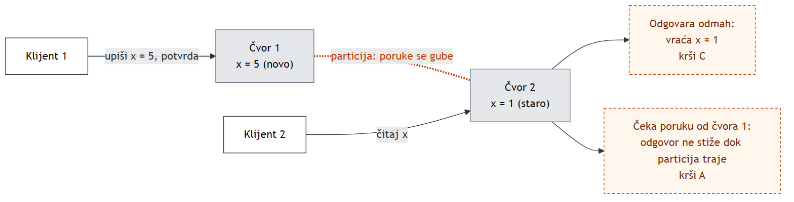
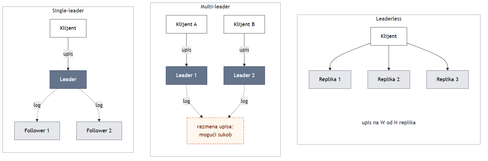
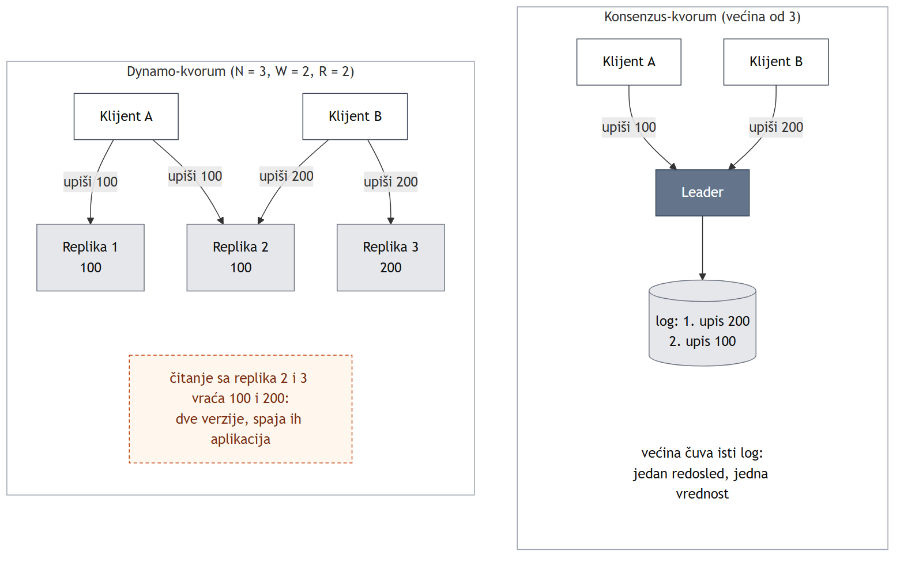
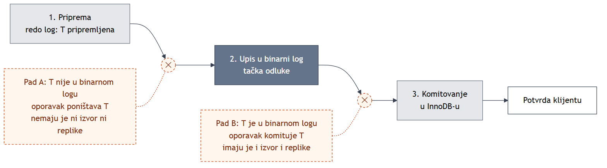
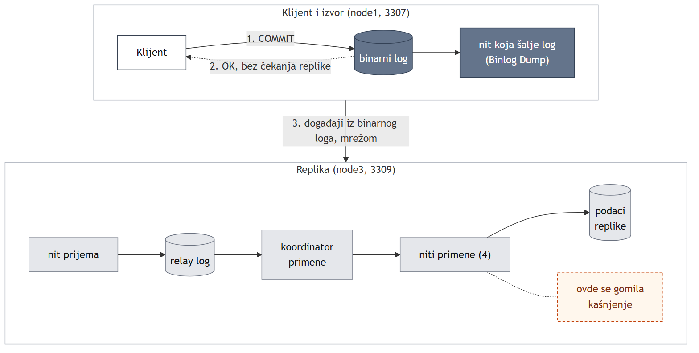
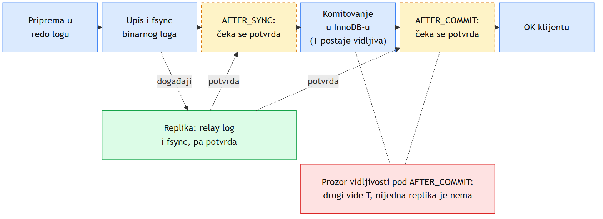
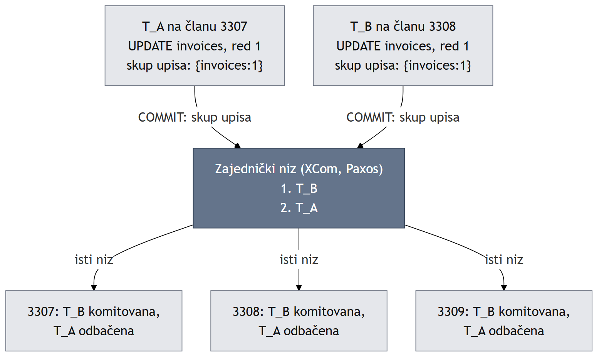

<!--
  The body of the paper. One chapter appended per session, by the academic-research-writer
  skill under the rules in ../WRITING.md. Never hand-written and tidied afterwards.

  Do NOT set `lang: sr` here - it forces the IEEE reference list into Cyrillic.
  The title page is a separate file (naslovna.md) and is prepended by ../tools/make-docx.ps1.
-->

# 1. Uvod

# 2. Teorijski okvir: modeli konzistentnosti, CAP/PACELC i konsenzus

Replikacija podrazumeva da isti podatak postoji na više čvorova. Čvorovi nemaju zajedničku memoriju
ni zajednički sat, pa se svaka informacija između njih prenosi porukom, a prenos poruke traje
[@lamport1978]. U asinhronoj mreži poruka može i da se izgubi, a čvor ne može da razlikuje
izgubljenu poruku od zakasnele, pa ni čvor koji je pao od čvora koji je samo spor ili odsečen
[@gilbert2002]. Upis zato ne stiže na sve kopije istovremeno, pa se postavlja pitanje šta čitanje sa
pojedinačne kopije sme da vrati. Ovo poglavlje uvodi rečnik kojim se na to pitanje odgovara, bez
ijednog MySQL mehanizma; kasnija poglavlja ga koriste bez ponovnog definisanja.

## Modeli konzistentnosti

Model konzistentnosti je ugovor između sistema i klijenta koji određuje koje vrednosti čitanje sme
da vrati dok se upisi šire kroz replike. Najjači takav ugovor je stroga konzistentnost (strong
consistency), formalno linearizabilnost (linearizability): svaka operacija izgleda kao da stupa na
snagu trenutno, u nekoj tački između svog poziva i svog odgovora [@herlihy1990], pa se sistem ponaša
kao da postoji samo jedna kopija podatka. Kada klijent dobije potvrdu upisa, svako kasnije čitanje
bilo kog klijenta mora da vidi tu vrednost ili noviju. Cena je ugrađena u samu definiciju: replika
pre odgovora mora da zna da poseduje sve završene upise, a to znanje može da stigne samo porukom.

Slabiji modeli su međusobno ugnežđeni, tako da jači model ispunjava sva obećanja slabijih. Uzročna
konzistentnost (causal consistency) oslanja se na Lamportovu relaciju „desilo se pre“ (happened
before) [@lamport1978]: ako je jedan upis mogao da utiče na drugi, svi čvorovi vide prvi upis pre
drugog, pa niko ne sme da vidi odgovor na pitanje pre samog pitanja. Na dnu je konačna
konzistentnost (eventual consistency), koja obećava samo to da će, ako novih upisa više nema, sva
čitanja na kraju vraćati poslednju upisanu vrednost [@vogels2008].

Između ovih krajnosti nalaze se sesijske garancije (session guarantees), definisane za pojedinačnu
sesiju klijenta, a ne za ceo sistem [@terry1994]. Read-your-writes (čitanje sopstvenih upisa) zahteva
da čitanja sesije odražavaju njene prethodne upise: korisnik koji promeni lozinku ne sme u sledećem
čitanju, sa replike koja kasni, da vidi staru. Monotona čitanja (monotonic reads) zahtevaju da
uzastopna čitanja odražavaju skup upisa koji se ne smanjuje, pa osvežena stranica ne sme da prikaže
stanje starije od već viđenog [@terry1994]. Anomaliju read-your-writes sedmo poglavlje meri na MySQL
topologiji.

## CAP i PACELC

Brewer je 2000. godine izneo pretpostavku da distribuirani sistem ne može istovremeno da obezbedi
konzistentnost, dostupnost i toleranciju na particiju mreže [@brewer2000], a Gilbert i Lynch su je
dve godine kasnije formalizovali i dokazali [@gilbert2002]. U njihovoj formulaciji C označava strogu
konzistentnost; A dostupnost (availability), odnosno da svaki zahtev koji primi čvor koji nije pao
dobije odgovor; a P particiju mreže (network partition), u kojoj mreža sme da izgubi proizvoljno
mnogo poruka između čvorova [@gilbert2002]. Suštinu dokaza prikazuje slika 2.1. Klijent je upisao
novu vrednost na čvor 1 i dobio potvrdu, a veza ka čvoru 2 je prekinuta. Ako čvor 2 odgovori na
čitanje, vraća staru vrednost posle završenog upisa i krši C; ako čeka poruku od čvora 1, ne
odgovara dok particija traje i krši A.

{width=100%}

Pravilo „izaberi dva od tri“ pogrešno je čitanje teoreme, na šta je upozorio i sam Brewer
[@brewer2012]. Particija nije svojstvo koje projektant bira, već događaj u mreži, pa se izbor svodi
na C ili A, i to samo dok particija traje; dok mreža radi, CAP ne zabranjuje da sistem bude
istovremeno strogo konzistentan i dostupan. C iz CAP-a pritom nije konzistentnost iz svojstava
ACID, koja znači da transakcija čuva pravila baze, poput jedinstvenosti ključeva, već samo
konzistentnost jedinstvene kopije, koju Brewer opisuje kao strogi podskup ACID konzistentnosti
[@brewer2012].

Ni bez particije stroga konzistentnost nije besplatna. Čvor koji pre potvrde hoće da zna da upis
postoji i na drugom čvoru mora da sačeka povratnu poruku, pa se ne gubi dostupnost, već se plaća
latencijom (latency), odnosno vremenom odziva. Abadi ovu razliku dodaje teoremi CAP, a proširenje se
može svesti na dva pitanja. Prvo glasi: kada mreža pukne, da li odsečeni čvor odgovara, rizikujući
zastareo odgovor, ili odbija zahtev, čuvajući konzistentnost? Drugo glasi: kada mreža radi, da li
komitovanje čeka druge čvorove, sporije ali konzistentno, ili ne čeka, brže ali uz rizik zastarelog
čitanja? Drugi kompromis prisutan je u svakom trenutku rada sistema, a CAP samo u, kako Abadi navodi,
verovatno retkom slučaju particije. Skraćenica PACELC beleži oba odgovora: ako postoji particija (P),
bira se između dostupnosti (A) i konzistentnosti (C), inače (E, else) između latencije (L) i
konzistentnosti (C) [@abadi2012]. Za ovaj rad presudno je drugo pitanje: svako podešavanje oblika
„sačekaj X pre potvrde“ u narednim poglavljima predstavlja odgovor upravo na njega.

## Modeli replikacije

Prvo projektantsko pitanje kod replikacije jeste koliko čvorova sme da primi upis. Kleppmann
razlikuje tri odgovora, single-leader, multi-leader i leaderless replikaciju [@kleppmann2017],
prikazana na slici 2.2. Ovo poglavlje za uloge čvorova koristi termine iz literature, *leader* i
*follower*; od trećeg poglavlja, kada predmet postane MySQL, prelazi se na nazive *izvor* i
*replika*. Kod single-leader replikacije upise prima tačno jedan čvor, a followeri primenjuju
njegov log, pa postoji jedan redosled upisa i nema sukoba; otvoreno ostaje šta se dešava kada
leader padne. Kod multi-leader replikacije upise prima više čvorova, pa dva istovremena upisa u
isti podatak čine sukob, koji neko mora da razreši [@kleppmann2017]. Kod leaderless replikacije, čiji
je uzor Amazonov sistem Dynamo, klijent upis smatra uspešnim kada ga potvrdi W od ukupno N replika,
a čitanje pita R replika; nijedan čvor ne određuje redosled upisa [@decandia2007].

{width=100%}

<!--
  Absence claim (../../NOTES.md rule 1), checked 2026-10-07, recorded in
  .scratch/replikacija/measurements/0003-theory-framework.md:
  rung 1, refman 8.4 ch. 19-20: async, semisync, delayed, Group Replication single/multi-primary,
  all leader- or group-ordered; rung 2, MySQL Shell 8.4 (InnoDB Cluster, ReplicaSet, ClusterSet):
  all built on Group Replication or single-source async. NDB Cluster out of scope, not asserted.
  Wording kept narrow on purpose: "dokumentuje", "Community", "u stilu sistema Dynamo".
-->
Nijedan oblik replikacije koji dokumentuje MySQL 8.4 Community nije leaderless u stilu sistema Dynamo:
svaki se oslanja ili na jedan čvor koji prima upise ili na grupu čvorova koja se dogovara o
redosledu upisa [@mysql84refman; @mysqlshell84].

## Konsenzus

Kada leader padne, neki follower mora da preuzme njegovu ulogu. Pošto čvor ne može da razlikuje
leadera koji je pao od leadera koji je samo odsečen, follower koji to samostalno zaključi rizikuje
da istovremeno postoje dva leadera koji primaju upise, odnosno split brain (razdvajanje grupe na
dve nezavisne celine). Čvorovi zato moraju da se slože oko toga ko je leader i šta se nalazi u logu,
i to tako da se dve grupe čvorova ne mogu složiti različito; taj problem naziva se konsenzus.
Klasično rešenje je Lamportov algoritam Paxos [@lamport2001], a algoritam Raft, projektovan da bude
razumljiviji, deli konsenzus na izbor leadera, replikaciju loga i bezbednost [@ongaro2014].

Sva tri dela oslanjaju se na jednu činjenicu: svake dve većine istog skupa od N čvorova imaju bar
jedan zajednički čvor. Svaki čvor u jednom mandatu (term) glasa najviše jednom, pa u istom mandatu
ne mogu postojati dva leadera; ulaz u logu je komitovan kada ga sačuva većina, pa pad manjine ne
zaustavlja sistem; a čvor ne glasa za kandidata čiji je log manje ažuran od njegovog, pa novi leader
neizbežno poseduje sve komitovane ulaze [@ongaro2014]. Protokol nijednom ne proverava da li je stari
leader zaista pao, već se oslanja isključivo na presek većina. Isti princip koristi MySQL Group
Replication: prema priručniku, da bi transakcija bila komitovana, većina grupe mora da se složi o
njenom mestu u globalnom redosledu transakcija, a u osnovi te tehnologije nalazi se implementacija
algoritma Paxos [@mysql84refman]. Tim mehanizmom bavi se peto poglavlje.

## Dva značenja kvoruma

Reč kvorum u literaturi označava dve različite stvari koje se oslanjaju na istu aritmetiku preseka.
Kod Dynamo-kvoruma uslov W + R > N obezbeđuje da se skup replika koje su potvrdile upis i skup
replika koje se čitaju seku, pa čitanje dodiruje bar jednu repliku sa najnovijom verzijom
[@decandia2007]. Presek, međutim, ne određuje redosled, što pokazuje leva strana slike 2.3: dva
istovremena upisa, vrednosti 100 i 200, dobijaju po dve potvrde, a replike završavaju sa
vrednostima 100, 100 i 200. Nijedan čvor nije odlučio koji je upis bio prvi, pa Dynamo čuva obe
verzije i njihovo spajanje prepušta aplikaciji [@decandia2007]. Abadi zato naglašava da ovakvi
sistemi ne dostižu punu konzistentnost u smislu Gilberta i Lynch ni kada je R + W > N [@abadi2012].

{width=85%}

Konsenzus-kvorum, na desnoj strani slike, isti presek koristi da bi se većina dogovorila o mestu
svakog upisa u jedinstvenom logu, pa dva istovremena upisa dobijaju dva različita mesta u
redosledu umesto dve verzije istog podatka [@ongaro2014]. Kada se u ovom radu govori o sistemima
zasnovanim na kvorumu, misli se na konsenzus-kvorum, jer na njemu počiva Group Replication, dok
Dynamo-kvorum služi samo kao kontrast. Time je zaokružen rečnik narednih poglavlja: svaki mehanizam
replikacije u MySQL-u biće smešten u jedan od tri modela, opisan modelom konzistentnosti koji
obezbeđuje i ocenjen prema tome kako odgovara na dva pitanja PACELC-a.

# 3. Binarni log, GTID i asinhrona replikacija

Replikacija u MySQL-u ne prenosi stanje baze, već zapis o promenama. Izvor svaku komitovanu
transakciju upisuje u binarni log (binary log), a replika te zapise preuzima i izvršava nad
sopstvenom kopijom podataka; isti log posle vraćanja rezervne kopije služi i za oporavak baze do
željenog trenutka [@mysql84refman]. Replika ponavljanjem loga stiže u isto stanje kao izvor ako obe
strane polaze od istog stanja i primenjuju iste promene istim redosledom. Redosled obezbeđuje sam
log: transakcija se u njega upisuje pre nego što se oslobode njena zaključavanja, pa log sledi
redosled komitovanja [@mysql84refman]. Poglavlje prati jednu transakciju od izvora do replike kroz
četiri pitanja: šta se upisuje u log, kada je upis postojan, kako replika zna dokle je stigla i kada
klijent dobija potvrdu.

Od ovog poglavlja uloge čvorova nazivaju se onako kako ih naziva MySQL: čvor čiji se binarni log
šalje drugima je izvor (source), a čvor koji taj log primenjuje je replika (replica); to su iste
uloge koje drugo poglavlje naziva *leader* i *follower*. Tim koji razvija MySQL naziv izvor
obrazlaže time da je replikacija tok promena, pa naziv ne određuje ulogu servera u celoj
arhitekturi, što je važno kod lančane ili dvosmerne replikacije [@gryp2020].[^uloge] Merenja u ovom
i narednim poglavljima izvedena su na tri instance servera MySQL 8.4.11 na jednom računaru, na
portovima 3307, 3308 i 3309, koje se u nastavku nazivaju node1, node2 i node3. Izvor je node1, a
node2 i node3 su njegove replike, sa uključenim GTID-ovima i formatom zapisa `ROW`. Kao primer služi
baza poliklinika, sa tabelama pacijenata, pregleda i računa, uz pomoćnu tabelu `heartbeat` za
merenje kašnjenja.

[^uloge]: Starija dokumentacija i veći deo literature ove uloge nazivaju master i slave. MySQL je
zamenu tih termina započeo 2020. godine [@gryp2020], a u verziji 8.4.0 uklonjene su i naredbe koje
su ih koristile, pa je, na primer, naredba `SHOW MASTER STATUS` zamenjena naredbom
`SHOW BINARY LOG STATUS` [@mysql84relnotes]. U ovom radu stari termini se dalje ne koriste.

## Binarni log i formati zapisa

Binarni log se vodi u tri formata, koji se razlikuju po tome da li beleže uzrok promene ili njenu
posledicu. Format `STATEMENT` upisuje sam SQL iskaz, koji replika ponovo izvršava (upisivanje
iskaza, statement-based logging). Format `ROW`, koji je podrazumevani, upisuje kako su se promenili
pojedinačni redovi tabele, a replika te promene kopira (upisivanje redova, row-based logging).
Format `MIXED` upisuje iskaze, a u određenim slučajevima automatski prelazi na upisivanje redova
[@mysql84refman]. Upisivanje iskaza je kompaktnije, jer iskaz koji menja hiljadu redova u logu
ostaje jedan iskaz, ali je pravac razvoja jasan: menjanje formata zastarelo je još u verziji 8.0, a
priručnik najavljuje da će upisivanje redova postati jedini format [@mysql84refman].

## Nesigurni iskazi

Upisivanje iskaza pretpostavlja da isti iskaz nad istim podacima daje isti rezultat. Iskaz za koji
to ne važi naziva se nesiguran iskaz (unsafe statement), jer replika koja ga ponovi može da stigne
u drugačije stanje od izvora. Priručnik kao primer navodi iskaze `UPDATE` i `DELETE` sa klauzulom
`LIMIT` bez `ORDER BY`, jer redosled redova na koje deluju nije definisan, kao i funkciju
`SYSDATE()`. Za takav iskaz server u formatu `STATEMENT` izdaje upozorenje, a u formatu `MIXED` ga
automatski upisuje kao redove [@mysql84refman].

Slika 3.1 prikazuje razliku na bazi poliklinika. Iskaz označava kao plaćena dva neplaćena računa za
koje je `tenant_id = 1`, uz `LIMIT 2` bez `ORDER BY`, pa ne određuje koja dva. U formatu `STATEMENT`
server izdaje upozorenje 1592, a u formatu `ROW` od klauzule `LIMIT` u logu ne ostaje trag, već samo
dva izmenjena reda, računi 11 i 18, sa slikom pre i posle izmene. Upisivanje redova nedeterminizam
ne uklanja, već izbor ostavlja izvoru, a replici šalje samo njegov ishod.

{width=90%}

## Postojanost: dva loga i dvofazno komitovanje

Potvrda komitovanja ima smisla samo ako transakcija preživi pad, a to zavisi od toga kada log
zaista stigne na disk. Upis u datoteku najpre dospeva u keš operativnog sistema, a na stabilnu
memoriju stiže kada ga sistem sam prenese ili kada proces to izričito zatraži pozivom `fsync()`, čiji
je ekvivalent na Windowsu `FlushFileBuffers` [@mysql84refman]. Zato pad procesa `mysqld` ne gubi ono
što je već predato operativnom sistemu, dok pad operativnog sistema ili nestanak napajanja gubi i
sadržaj keša. InnoDB postojanost obezbeđuje tehnikom write-ahead logging (WAL): opis izmene se pre
izmene stranica sa podacima upisuje u redo log, koji se koristi pri oporavku posle pada
[@mysql84refman].

MySQL, međutim, istu transakciju beleži u dva loga. Redo log pripada mehanizmu skladištenja
(storage engine) InnoDB, a binarni log vodi serverski sloj iznad njega, nezavisno od motora
[@mysql84refman]. Ako posle pada transakcija ostane samo u jednom od njih, izvor i replike se trajno
razilaze, a nijedan čvor ne prijavljuje grešku. Tu opasnost otklanja interno dvofazno komitovanje
(two-phase commit), u verziji 8.4 uvek uključeno i prikazano na slici 3.2. InnoDB transakciju
najpre upisuje u redo log kao pripremljenu (prepare), zatim se ona upisuje u binarni log i on se
sinhronizuje na disk, a tek tada je InnoDB komituje. Odluku o ishodu time donosi binarni log: posle
pada server dovršava pripremljene transakcije koje su upisane u binarni log, pa log tačno odražava
sadržaj tabela, a replika ne dobija transakciju koja je na izvoru poništena [@mysql84refman].

{width=100%}

Koliko je ova zaštita stvarno jaka, zavisi od toga da li se svaki log pri komitovanju sinhronizuje
na disk. Za binarni log o tome odlučuje `sync_binlog`: vrednost 1 sinhronizuje ga pre komitovanja, a
vrednost 0 sinhronizaciju prepušta operativnom sistemu. Za redo log odlučuje
`innodb_flush_log_at_trx_commit`: vrednost 1, neophodna za punu usklađenost sa svojstvima ACID,
sinhronizuje ga pri svakom komitovanju, a vrednost 2 ga pri komitovanju samo upisuje, dok ga
sinhronizuje jednom u sekundi [@mysql84refman]. Tabela 3.1 navodi šta od svake kombinacije ostaje
posle pada operativnog sistema. Ishode prvog i trećeg reda navodi priručnik, a ostali su izvedeni iz
razlike između upisa i sinhronizacije. Najopasniji je drugi red: binarni log sadrži transakciju čija
je priprema izgubljena iz redo loga, pa je replike imaju, a izvor ne, što je upravo razilaženje koje
je dvofazno komitovanje trebalo da spreči. Priručnik zato preporučuje vrednosti 1 i 1, uz upozorenje
da ni one nisu garancija na diskovima koji na zahtev za sinhronizaciju odgovaraju da je obavljena,
iako nije [@mysql84refman]. Koliko ta sigurnost košta u vremenu odziva, meri se u četvrtom
poglavlju.

| Binarni log | Redo log | Posle pada operativnog sistema ili nestanka napajanja |
|:------------:|:------------:|:------------------------------------------------------------|
| 1 | 1 | najveća postojanost i konzistentnost (preporuka priručnika) |
| 1 | 2 | binarni log ima transakciju, a redo log nema njenu pripremu: replike je imaju, izvor ne |
| 0 | 1 | izvor može imati komitovane transakcije kojih nema u binarnom logu: izvor ih ima, replike ne |
| 0 | 2 | gube se transakcije iz poslednje sekunde, a dva loga mogu da se raziđu |

Table: Tabela 3.1: Šta se gubi pri padu operativnog sistema, za svaku kombinaciju vrednosti `sync_binlog` (binarni log) i `innodb_flush_log_at_trx_commit` (redo log). Pad samog procesa mysqld ni u jednoj kombinaciji ne gubi komitovane transakcije.

## GTID i automatsko pozicioniranje

Replika mora da zna dokle je u logu izvora stigla, da bi posle prekida veze nastavila od prave
transakcije. Tradicionalni način je par koji čine ime datoteke binarnog loga i pozicija u njoj, ali
taj par je adresa u logu jednog servera, a ne ime transakcije: ista transakcija na izvoru i na
replici leži u različitim datotekama, na različitim pozicijama. Globalni identifikator transakcije
(GTID) transakciji daje ime koje putuje sa njom. Dodeljuje se pri komitovanju na izvoru, jedinstven
je u celoj topologiji i ima oblik `source_id:transaction_id`, gde je prvi deo obično `server_uuid`
izvora, a drugi redni broj transakcije na njemu. Server preskače svaku transakciju čiji je GTID već
izvršio, pa se transakcija na jednom serveru primenjuje najviše jednom [@mysql84refman].

<!--
  Absence-claim check (../../NOTES.md rule 1), 2026-10-09. The failover sentences below are worded
  as the manual's positive procedure, not as "MySQL cannot fail over asynchronously":
  rung 1, refman 8.4 sec. 19.4.8 "Switching Sources During Failover": "you can pick one of the
  replicas to become the new source", then CHANGE REPLICATION SOURCE TO.
  rung 1, refman 8.4 "Asynchronous Connection Failover for Sources" EXISTS: with GTIDs and
  SOURCE_AUTO_POSITION a replica re-points automatically to another source from a stored list.
  It re-points a connection; it is not documented as promoting a replica. So no sentence here may
  say asynchronous replication has no automatic failover of any kind. Ch. 5/6 own the automation.
-->
Uz opciju `SOURCE_AUTO_POSITION = 1` naredbe `CHANGE REPLICATION SOURCE TO` replika pri povezivanju
ne navodi ni datoteku ni poziciju, već šalje skup GTID-ova koje već ima, a izvor joj šalje sve
transakcije iz svog binarnog loga čiji GTID nije u tom skupu [@mysql84refman]. Automatsko
pozicioniranje je, dakle, razlika dva skupa, a ne traženje adrese; obe replike u topologiji ovog
rada pokrenute su upravo tako, od praznog skupa. GTID-ovi pojednostavljuju i failover (preuzimanje
uloge izvora nakon otkaza), ali samo pozicioniranje, ne i odluku: prema priručniku, kada izvor
otkaže, operater bira repliku koja postaje novi izvor i na nju preusmerava ostale replike
[@mysql84refman]. Mehanizmi koji tu odluku donose automatski predmet su petog i šestog poglavlja.

## Niti replikacije i mesto kašnjenja

Put transakcije od izvora do podataka replike prikazan je na slici 3.3. Na izvoru, za svaku
povezanu repliku, po jedna nit koja šalje log (binlog dump thread) čita binarni log i šalje njegov
sadržaj replici. Na replici nit prijema (receiver thread) kopira primljene događaje u relay log, a
koordinator primene ih raspoređuje nitima primene (applier threads), kojih u verziji 8.4 podrazumevano
ima četiri. Uz podrazumevanu vrednost `replica_preserve_commit_order = ON` niti primene komituju
transakcije redosledom iz relay loga, pa replika, uz ograničenja koja priručnik navodi, zadržava
istu istoriju transakcija kao izvor [@mysql84refman].

{width=90%}

Ova podela objašnjava gde nastaje kašnjenje replikacije (replication lag). Nit prijema samo kopira
bajtove, dok niti primene moraju da izvrše transakcije koje je na izvoru istovremeno izvršavalo
mnogo sesija, pa je primena po pravilu sporija od prijema. To potvrđuje i merenje na topologiji
ovog rada: kada je izvor u naletu upisao četiri hiljade jednorednih transakcija, a replika node2
imala samo jednu nit primene, relay log je prestao da raste posle približno tri sekunde, dok je
kašnjenje primene raslo i posle deset sekundi. Kašnjenje se, dakle, gomila iza relay loga, a ne u
mreži, i to je polazište sedmog poglavlja.

## Asinhrona potvrda

Replikacija u MySQL-u je podrazumevano asinhrona [@mysql84refman]: izvor transakciju komituje i
klijentu vraća potvrdu, a da nijedna replika ne mora da je primi. Zato na slici 3.3 postoji prozor
u kome potvrđena transakcija postoji samo na izvoru. Ako izvor u tom prozoru trajno otkaže, na
primer zbog kvara diska, replike transakciju nikada neće dobiti, jer događaje dobijaju isključivo od
niti koja ih na izvoru šalje, a postojanost iz prethodnih odeljaka štiti transakciju samo na disku
izvora. Kada se zatim jedna od replika unapredi u izvor, sistem se vraća u stanje starije od
potvrđenog upisa, što stroga konzistentnost iz drugog poglavlja zabranjuje.

U terminima PACELC-a asinhrona replikacija na drugo pitanje odgovara bez zadrške: komitovanje ne
čeka druge čvorove, pa se bira latencija, a cenu plaćaju klijenti koji čitaju sa replika i, pri
otkazu izvora, sami potvrđeni upisi. Format zapisa i promenljive `sync_binlog` i
`innodb_flush_log_at_trx_commit` određuju samo šta je u logu i koliko je on postojan na izvoru. Ono
što se menja nije log, već trenutak u kome pisac dobija potvrdu, a asinhrona replikacija taj
trenutak postavlja najranije što je moguće. Četvrto poglavlje ga pomera, uvodeći semisinhronu
replikaciju, u kojoj izvor pre potvrde čeka da bar jedna replika primi transakciju.

# 4. Semisinhrona replikacija i značenje potvrde

Semisinhrona replikacija pomera trenutak potvrde: pre nego što klijentu vrati odgovor, izvor čeka
da bar jedna replika potvrdi prijem transakcije [@mysql84refman]. Lako ju je pročitati kao
podešavanje brzine, a ovo poglavlje pokazuje da je reč o odluci o konzistentnosti, polazeći od
pitanja šta potvrda (acknowledgement) zapravo obećava. Replika potvrđuje prijem tek pošto događaje
upiše u relay log i sinhronizuje ga na disk [@mysql84refman]. Potvrda, dakle, znači da transakcija
postoji na disku još jednog čvora, a ne da ju je replika primenila, pa čitanje sa replike i posle
potvrde može da vrati staru vrednost.

U verziji 8.4 semisinhronu replikaciju ostvaruju dva dodatka (plugin), jedan na izvoru i jedan na
replici, koji se instaliraju naredbom `INSTALL PLUGIN`; na Windowsu su to biblioteke
`semisync_source.dll` i `semisync_replica.dll`, a na sistemima Unix odgovarajuće datoteke sa
nastavkom `.so`. Dodaci su podrazumevano isključeni i uključuju se promenljivama
`rpl_semi_sync_source_enabled` i `rpl_semi_sync_replica_enabled`. Izvor podrazumevano čeka potvrdu jedne
replike [@mysql84refman].

## Tačka čekanja: AFTER_SYNC i AFTER_COMMIT

Treće poglavlje pokazalo je da o ishodu transakcije odlučuje upis u binarni log. Šta drugi klijenti
vide, međutim, ne određuje binarni log, već komitovanje u InnoDB-u, koje u dvofaznom komitovanju
dolazi posle njega. Odluka i vidljivost su dva različita trenutka, pa izvor potvrdu može da čeka na
dva mesta, prikazana na slici 4.1. Tačku čekanja (wait point) bira promenljiva
`rpl_semi_sync_source_wait_point`. Uz podrazumevanu vrednost `AFTER_SYNC` izvor čeka posle
sinhronizacije binarnog loga, a pre komitovanja u InnoDB-u, pa svi klijenti transakciju vide
istovremeno, tek pošto ju je replika potvrdila. Uz `AFTER_COMMIT` izvor čeka posle komitovanja u
InnoDB-u, pa drugi klijenti transakciju vide pre klijenta koji ju je upisao [@mysql84refman]. Verzije
starije od 5.7.2, u kojoj je izbor uveden, ponašale su se kao `AFTER_COMMIT` [@mysql572relnotes].

{width=100%}

Interval u kome drugi klijenti vide transakciju, a nijedna replika je nema, u ovom radu naziva se
prozor vidljivosti. Na jednom računaru on traje koliko povratno putovanje (round-trip time) do
replike, prekratak da bi se pouzdano izmerio, pa je u merenju veštački produžen: na obe replike
zaustavljena je nit prijema, tako da potvrda nije stizala, a istek vremena postavljen je na tri
sekunde. Druga sesija na izvoru proveravala je postojanje novog reda u razmacima kraćim od jedne
milisekunde. Uz `AFTER_SYNC` red je postao vidljiv u istom trenutku u kome je pisac dobio
potvrdu, pa prozora nije bilo. Uz `AFTER_COMMIT` druga sesija videla je red posle pet milisekundi,
tri sekunde pre pisca, dok ga nijedna replika nije imala.

## Čitanje koje failover poništava

Prozor postaje anomalija kada izvor u njemu otkaže. U drugom merenju, uz `AFTER_COMMIT`, druga
sesija pročitala je novi red dok je pisac još čekao potvrdu. Proces izvora zatim je prinudno
zaustavljen, a node2 unapređen u izvor. Pisac je dobio grešku o prekinutoj vezi, ali reda nema ni
na node2 ni na node3: klijent je pročitao podatak koji je sistem posle failovera izgubio. Anomaliju,
dakle, ne trpi pisac, već čitalac. Ona krši strogu konzistentnost, ali i znatno slabija monotona
čitanja, jer čitalac koji se posle failovera poveže na novi izvor vidi stanje starije od već
viđenog. Priručnik ovu mogućnost navodi izričito: uz `AFTER_COMMIT` klijenti mogu da uoče gubitak
podataka u odnosu na ono što su videli na izvoru [@mysql84refman]. Razlika između dve tačke čekanja
zato nije razlika u brzini, već u tome da li sistem sme da pokaže ono što ne može da sačuva.

<!--
  Absence-claim check (../../NOTES.md rule 1), 2026-10-11, researcher. The paragraph below states
  measured behaviour plus the manual's positive instruction ("should be discarded"); it does NOT
  say "MySQL has no mechanism that discards never-acked binlog transactions on recovery".
  rung 1, refman 8.4 sec. 19.4.10: failed source "should not be reused ... It could have
  transactions that were not acknowledged by any replica"; sec. 7.4.4: the only binlog truncation
  on recovery is to the last valid position (XID-based, not ack-based).
  rung 2, 8.0 / 8.4 release-note indexes: no semisync recovery feature (index-level, weak).
  rung 4, MySQL Bug #99370 (closed): Oracle calls keeping un-acked transactions "expected behavior,
  a limitation that applies to the whole concept of semi-sync". MariaDB does truncate (init_rpl_role,
  MDEV-33465): contrast only, not used.
  rung 5, live topology: measurement 0006 M3/M4, both wait points.
-->
Failover je u trećem poglavlju definisan kao preuzimanje uloge izvora nakon otkaza, a njegova
suprotnost je switchover (planirana promena uloga). Pri switchoveru stari izvor je dostupan, pa se
pre promene usklađuje sa novim i postaje replika, dok failover unapređuje repliku bez usklađivanja
sa starim izvorom [@mysqlshell84]. Zato priručnik propisuje da otkazali semisinhroni izvor ne treba
ponovo koristiti, već ga treba odbaciti, jer može da sadrži transakcije koje nijedna replika nije
potvrdila [@mysql84refman].

Merenje pokazuje da ovo važi i uz `AFTER_SYNC`. Ponovo pokrenut node1 imao je izgubljeni red pri
obe tačke čekanja. Uz `AFTER_SYNC` transakcija je u trenutku pada bila pripremljena i upisana u
binarni log, pa ju je oporavak, po pravilu dvofaznog komitovanja, komitovao, iako je nijedna
replika nije potvrdila niti ju je iko video. Stari izvor tako ima višak transakcija (errant
transactions), sa GTID-om koji novi izvor nema. Povezan zatim kao replika na node2 uz automatsko
pozicioniranje, node1 je pokrenuo obe niti bez ijedne greške, a kontrolni zbirovi tabele na dva
čvora su se razlikovali. MySQL odbija repliku koja ima više transakcija od izvora samo kada te
transakcije nose identifikator samog izvora [@mysql84refman], a ovaj višak nosi identifikator
starog izvora, pa je razilaženje tiho. Višak nije moguće ni jednostavno proslediti novom izvoru:
dva čvora čiji su se logovi razišli postaju dva izvora upisa, odnosno multi-leader replikacija iz
drugog poglavlja, sa sukobom koji niko ne razrešava.

## Istek vremena i tiha degradacija

Izvor ne čeka potvrdu neograničeno. Ako je nijedna replika ne pošalje u roku
`rpl_semi_sync_source_timeout`, podrazumevano deset sekundi, izvor se vraća na asinhronu
replikaciju, a semisinhronoj se vraća tek kada ga neka replika sustigne [@mysql84refman]. Klijent
pri tome ne dobija grešku, već uobičajenu potvrdu. Na topologiji ovog rada, uz istek vremena od
jedne sekunde i zaustavljene niti prijema, prvo komitovanje čekalo je punu sekundu i uspelo, a već
drugo trajalo je manje od milisekunde, kao asinhrono. Tiha degradacija nije kvar, već podrazumevani
izbor: kada replike nisu dostupne, izvor bira dostupnost, a ne konzistentnost.

Pošto klijent degradaciju ne vidi, uočavanje je posao operatera. U merenjima su je pokazali
sledeći znaci: promenljiva statusa `Rpl_semi_sync_source_status` prelazi sa `ON` na `OFF`;
rastu `Rpl_semi_sync_source_no_tx`, broj nepotvrđenih transakcija, i
`Rpl_semi_sync_source_no_times`, broj isključivanja semisinhrone replikacije; brojač potvrđenih
transakcija `Rpl_semi_sync_source_yes_tx` prestaje da raste; u logu grešaka pojavljuje se
upozorenje MY-011153 o isteku vremena; a jedno komitovanje traje koliko ceo istek vremena. Broj
povezanih semisinhronih replika, `Rpl_semi_sync_source_clients`, nije pouzdan znak: u jednom
merenju pao je na nulu, a u drugom je ostao 2, iako su obe niti prijema bile zaustavljene.

## Cena potvrde

Prema priručniku, semisinhrona replikacija komitovanje produžava najmanje za jedno povratno
putovanje do replike po protokolu TCP/IP [@mysql84refman]. Tabela 4.1 prikazuje prosečno trajanje
komitovanja za četiri kombinacije postojanosti iz tabele 3.1, bez semisinhrone replikacije i sa
njom. U prva tri reda razlika je mala i nema stalan smer, a ponovljena merenja za prvi red
pokazuju da je manja od njihovog rasipanja: povratno putovanje na jednom računaru kraće je od
sinhronizacija diska koje komitovanje ionako čeka. Tek kada se obe sinhronizacije isključe, cena
potvrde postaje vidljiva i trajanje komitovanja se udvostručuje. Sa rastojanjem između čvorova
raste i povratno putovanje, čemu se vraća šesto poglavlje.

| `sync_binlog` | `innodb_flush_log_at_trx_commit` | Asinhrona (µs) | Semisinhrona, `AFTER_SYNC` (µs) |
|:---:|:---:|---:|---:|
| 1 | 1 | 913 | 914 |
| 1 | 2 | 355 | 406 |
| 0 | 1 | 634 | 533 |
| 0 | 2 | 61 | 124 |

Table: Tabela 4.1: Prosečno trajanje komitovanja jednoredne transakcije na izvoru (node1), sa dve replike na istom računaru, MySQL 8.4.11. Svaka ćelija je prosek 300 komitovanja; prvi red je prosek tri naizmenično ponovljena para merenja.

Semisinhrona replikacija na drugo pitanje PACELC-a odgovara drugačije od asinhrone: komitovanje
čeka jedan drugi čvor. Garancija koju time dobija uža je, međutim, nego što naziv sugeriše.
Potvrda znači da je transakcija na disku jedne replike, a ne da je primenjena; važi samo dok ne
istekne vreme čekanja; uz `AFTER_COMMIT` ne sprečava čitanje koje failover poništava; i ni uz
jednu tačku čekanja ne čini otkazali izvor ponovo upotrebljivim. Tačku čekanja, broj potvrda i
istek vremena bira operater, a od tog izbora, i od toga da li prati znake degradacije, zavisi koju
konzistentnost sistem zaista pruža. Peto poglavlje prelazi na Group Replication, u kojoj komitovanje
znači da se o mestu transakcije u redosledu složila većina grupe.

# 5. Group Replication: kvorum, certification i multi-primary

Na jednom serveru redosled sukobljenih upisa određuje zaključavanje reda: od dve transakcije koje
menjaju isti red, druga čeka prvu, pa redosled postoji pre nego što ijedna dobije potvrdu. Kada
upise primaju dva čvora koji odlučuju nezavisno, oba mogu da potvrde upis u isti red, a kopije
podataka se razilaze; to je sukob multi-leader replikacije iz drugog poglavlja. Group Replication
ovaj problem rešava tako što se čvorovi grupe dogovore o redosledu pre nego što klijent dobije
potvrdu. Članovi grupe poruke razmenjuju preko sistema za grupnu komunikaciju XCom, varijante
algoritma Paxos, koji svim članovima isporučuje sve poruke istim redosledom [@mysql84refman]. Taj
redosled se u ovom radu naziva zajednički niz (total order). Na topologiji ovog rada grupa od tri
člana podignuta je pomoću alata MySQL Shell, kao InnoDB Cluster, čiju osnovu čini Group Replication
[@mysqlshell84].

## Certification: jedan niz, ista presuda

Transakcija se najpre izvršava lokalno, na članu koji ju je primio, bez koordinacije sa ostalim
članovima. Tek pri komitovanju član grupi šalje izmenjene redove i skup upisa (write-set), odnosno
jedinstvene identifikatore redova koje je transakcija izmenila [@mysql84refman]. Zajednički niz
zatim svakom članu isporučuje transakcije istim redosledom, a svaki član za sebe proverava da li
transakcija menja red koji je već izmenila neka transakcija ispred nje u nizu, a koju ona nije
videla. Taj korak MySQL naziva certification (provera saglasnosti transakcija). Kod sukoba
komituje transakcija koja je u nizu prva, a druga se odbacuje na svim članovima; priručnik ovo
naziva distribuiranim pravilom first commit wins [@mysql84refman], koje se u ovom radu prevodi kao
prvi po redosledu pobeđuje. „Prvi“ pri tome znači prvi u nizu, a ne prvi po satu nekog čvora.
Glasanja nema: svi članovi vide isti niz i iste podatke, pa samostalno donose istu presudu, kao na
slici 5.1.

{width=100%}

Pošto se sukob prepoznaje po identifikatoru reda, svaka tabela mora da ima primarni ključ ili
njegov ekvivalent, jedinstveni ključ čije kolone ne dozvoljavaju vrednost NULL [@mysql84refman]. Na
topologiji je to provereno pomoćnom tabelom `no_pk_demo` bez primarnog ključa: grupa je prihvatila
naredbu `CREATE TABLE`, ali je prvi `INSERT` odbijen greškom 3098, a provera instance u MySQL Shellu
upozorila je da se tabela može čitati, ali ne i menjati. Tabela je zatim uklonjena.

Sukob je izazvan u režimu sa više primarnih čvorova (multi-primary), u kome upise primaju svi
članovi. Dve transakcije, na članovima 3307 i 3308, menjale su isti red tabele `invoices`. Komitovala
je ona koja je prva stigla u niz, iako je otvorena kasnije, a druga je pri komitovanju dobila grešku
`ERROR 1180` sa porukom „Lock deadlock; Retry transaction“. Sva tri člana završila su sa vrednošću
pobednika. Kada su dve transakcije, sa istim vremenskim rasporedom, menjale dva različita reda iste
tabele, komitovale su obe, pa se sukob utvrđuje po redu, a ne po tabeli. Gubitnik pri tome ne dobija
posebnu grešku sukoba, već opštu grešku pri komitovanju, pa aplikacija mora da je prepozna i da
transakciju ponovi.

## Kvorum: manjina čeka, ne razilazi se

Transakcija dobija mesto u nizu tek kada se o njemu složi većina grupe, pa grupa od tri člana
podnosi otkaz jednog [@mysql84refman]. Ponašanje bez većine izmereno je tako što su procesi članova
3308 i 3309 prinudno zaustavljeni; uredno gašenje servera nije moglo da posluži, jer uredno
napuštanje grupe uklanja člana iz grupe, pa se većina računa nad preostalim članovima. Ishod na
preživelom članu 3307, koji je i dalje bio primarni, prikazuje tabela 5.1. Čitanje je vraćeno za
nekoliko desetina milisekundi, ali upis nije bio ni komitovan, ni odbijen, ni vidljiv drugim
sesijama. Priručnik ovo stanje opisuje rečima da grupa ne može da napreduje i da se blokira, jer ne
može da obezbedi većinu, odnosno kvorum [@mysql84refman]. Uloga primarnog člana određuje samo gde se
upisi primaju, a o njihovom ishodu odlučuje većina.

| Korak na članu 3307 | Ishod |
|---|---|
| `SELECT COUNT(*)` nad tabelom `patients` | vraćeno posle 39 ms |
| `INSERT` u tabelu `heartbeat` | blokirano i posle 30 s, klijent prekinut |
| čitanje tog reda iz druge sesije | 0 redova, posle 28 ms |
| `forceQuorumUsingPartitionOf()` u MySQL Shellu | kvorum obnovljen nad jednim članom |
| isti red, posle obnove kvoruma | komitovan, oko dva minuta posle slanja |

Table: Tabela 5.1: Gubitak kvoruma u grupi od tri člana. Procesi članova 3308 i 3309 prinudno su zaustavljeni, a merenje je izvedeno na preživelom članu 3307 (MySQL 8.4.11, `group_replication_unreachable_majority_timeout = 0`).

Ovo je ponašanje koje drugo poglavlje očekuje od konsenzusa. Manjina koja bi nastavila da prima
upise izazvala bi split brain (razdvajanje grupe na dve nezavisne celine), odnosno dve grupe članova
čiji se logovi razilaze. Član bez većine, međutim, ne može da dobije mesto u nizu, pa ne može ni da
komituje upis koji bi se razišao sa većinom. U terminima teoreme CAP grupa za upise bira
konzistentnost, a ne dostupnost, dok čitanja i dalje opslužuje, i to stanjem koje je imala pre
gubitka većine. Podrazumevana vrednost promenljive `group_replication_unreachable_majority_timeout`
je nula, pa član čeka neograničeno; uz pozitivnu vrednost član po isteku tog vremena poništava
transakcije na čekanju i prelazi u stanje greške [@mysql84refman].

Izlaz iz ovog stanja je odluka operatera. Naredba `forceQuorumUsingPartitionOf()` proglašava
preživele članove novom grupom [@mysqlshell84], a sam alat pri tome upozorava da ostale članove
treba ukloniti ili vratiti u obnovljenu grupu kako bi se izbegao split brain. Posle prisilnog
obnavljanja kvoruma upis koji je čekao komitovan je, iako je njegov klijent odavno bio prekinut:
transakcija nije bila poništena, već zadržana u komitovanju. Grupa, dakle, sama ne bira dostupnost,
ali operater može da je izabere, i tada preuzima rizik koji je grupa odbijala da preuzme.

## Jedan ili više primarnih čvorova

<!--
  Absence-claim check (../../NOTES.md rule 1), 2026-10-23, researcher, recorded in
  .scratch/replikacija/measurements/0007-group-replication-lesson.md section 5:
  rung 1, refman 8.4 sec. 19.4.9 Asynchronous Connection Failover re-points a replica's connection
  automatically to another source from a stored list; it is not documented as promoting a replica.
  So the text below contrasts WHO PROMOTES, and does not say "async has no automatic failover".
  Rung 1, sec. 20.1.3.1: primary election in single-primary mode is automatic.
-->
Podrazumevani režim je režim sa jednim primarnim čvorom (single-primary): grupa automatski bira
jednog člana koji prima upise, a ostali rade samo za čitanje, uz `super_read_only = ON`
[@mysql84refman]. Na topologiji je pokušaj upisa na sekundarnom članu 3308 odbijen greškom 1290.
Kada primarni član otkaže, grupa sama bira novog [@mysql84refman]. Razlika u odnosu na asinhronu
replikaciju nije u tome da li se veze automatski preusmeravaju, jer i replika u asinhronoj
replikaciji može sama da se poveže na drugi izvor sa unapred zadatog spiska (Asynchronous
Connection Failover) [@mysql84refman]. Razlika je u tome ko unapređuje novi izvor: u asinhronoj
replikaciji to čini operater ili spoljni alat, a u Group Replication sama grupa.

<!--
  Derived, not measured, and not in the manual (rule 1 check, 2026-10-23, researcher, rung 1):
  refman 8.4 group-replication-multi-primary-mode, -limitations, -use-cases, -summary make no claim
  that multi-primary scales writes; the only "write scale-out" sentence is about sharding with one
  group per shard. The paragraph below therefore states the scaling verdict as derived.
-->
U režimu multi-primary sukobe razrešava certification, a sam režim ima ograničenja: odbija nivo
izolovanosti `SERIALIZABLE`, ne podržava strane ključeve sa kaskadnim akcijama i ne podržava
istovremene DDL i DML naredbe nad istim objektom sa različitih članova [@mysql84refman]. Primer
`poliklinika` nema kaskadnih stranih ključeva, pa je režim na njemu bio dostupan. Više primarnih
čvorova, međutim, ne umnožava kapacitet upisa: svaki član čuva sve podatke, pa primenjuje svaki
komitovan red, i svoj i tuđ, a među članovima se raspoređuje samo izvršavanje naredbi. Ovaj
zaključak izveden je iz načina rada, a ne izmeren. Multi-primary je zato opravdan samo kada upise
mora da prima više članova istovremeno, a sukoba je malo; u ostalim slučajevima single-primary
pruža istu zaštitu od razilaženja, bez odbačenih transakcija koje aplikacija mora da ponavlja.

## Nivo konzistentnosti: ko čeka

Komitovanje u grupi znači da je većina primila transakciju i da je transakcija dobila mesto u nizu,
a ne da su je svi članovi primenili. Odluka i vidljivost su ponovo dva različita trenutka, kao u
četvrtom poglavlju, pa čitanje sa sekundarnog člana i posle potvrde može da vrati staru vrednost.
Promenljiva `group_replication_consistency` određuje ko čeka da se taj razmak zatvori, a može se
postaviti globalno ili za pojedinačnu sesiju [@mysql84refman]. Uz `EVENTUAL` ne čeka niko. Uz
`BEFORE` transakcija sesije koja ga je postavila pre izvršavanja čeka da se primene sve transakcije
ispred nje u nizu. Uz `AFTER` transakcija koja upisuje završava komitovanje tek kada je primene svi
ostali članovi, a na transakcije koje samo čitaju ne utiče. `BEFORE_AND_AFTER` spaja oba čekanja
[@mysql84refman]. Podrazumevana vrednost u verziji 8.4 je `BEFORE_ON_PRIMARY_FAILOVER`
[@mysql84relnotes], koja zadržava nove transakcije samo na novoizabranom primarnom članu, dok ne
primeni transakcije zaostale od prethodnog [@mysql84refman], pa se u stabilnom radu ponaša kao
`EVENTUAL`.

| Nivo (sesija na kojoj je postavljen) | Zastarela čitanja | Pisac (ms) | Čitalac (ms) | Model iz 2. poglavlja (izvedeno) |
|------------------------------|---------------:|-----------:|------------:|------------------------------|
| `BEFORE_ON_PRIMARY_FAILOVER` (podrazumevani) | 80/80 | 16 | 0 | konačna |
| `EVENTUAL` (čitalac) | 79/80 | 15–16 | 0 | konačna |
| `BEFORE` (čitalac) | 0/80 | 16 | 14–16 | stroga, za to čitanje |
| `AFTER` (pisac) | 0/40 | 29 | – | read-your-writes za sve čitaoce |
| `BEFORE_AND_AFTER` (pisac) | 0/40 | 31 | – | stroga |

Table: Tabela 5.2: Nivoi konzistentnosti u grupi sa jednim primarnim čvorom: upis od 5000 redova na primarnom članu 3307, zatim čitanje njegovog poslednjeg reda na sekundarnom članu 3309 odmah posle potvrde (MySQL 8.4.11). Vremena su medijane. Prva tri reda su dve serije od po 40 ponavljanja, a poslednja dva jedna serija iz ranijeg merenja, u kome vreme čitanja nije mereno. Povezivanje sa modelima izvedeno je u ovom radu.

Tabela 5.2 je mesto na kome se rečnik drugog poglavlja susreće sa jednim podešavanjem MySQL-a. Uz
podrazumevani nivo i uz `EVENTUAL` čitanje sa člana 3309, izvršeno odmah posle potvrde upisa na
članu 3307, vratilo je staru vrednost u gotovo svim ponavljanjima, što je anomalija read-your-writes
(čitanje sopstvenih upisa) iz drugog poglavlja. `BEFORE`, postavljen samo na sesiji čitaoca,
uklonio je sva zastarela čitanja: pisac je potvrdu dobijao jednako brzo kao ranije, a čitanje je,
umesto odmah, trajalo približno koliko i primena transakcije. `AFTER` i `BEFORE_AND_AFTER`,
postavljeni na sesiji pisca, takođe su uklonili sva zastarela čitanja, ali je medijana komitovanja
porasla sa 16 na oko 30 milisekundi. Zatvaranje razmaka u oba slučaja košta približno jedno vreme
primene, a nivo bira samo ko ga plaća. Razlika ima i praktičnu posledicu: `BEFORE` štiti samo sesiju
koja ga je postavila, pa zahteva izmenu čitaoca, dok `AFTER` štiti svakog čitaoca tog upisa, pa je
jedini izbor kada se čitalac ne može menjati.

<!--
  Rule 1 / derived-mapping check, 2026-10-23, researcher, rung 1 (measurement 0007 section 5 and the
  ticket-17 writing session): the consistency pages of refman 8.4 never use "linearizable" or
  "read your writes"; "strong consistency" appears only in sec. 20.5.3.2 Scenario 6, which
  recommends SET @@SESSION.group_replication_consistency = 'AFTER' for access-permission changes.
  The level-to-model mapping in Tabela 5.2 is ours; AFTER-is-not-linearizable is derived.
-->
Povezivanje nivoa sa modelima izvedeno je u ovom radu, a najviše pažnje traži `AFTER`. Priručnik
ga preporučuje upravo za slučaj u kome je potrebna stroga konzistentnost (strong consistency), na
primer pri promeni prava pristupa dokumentima [@mysql84refman], ali u smislu drugog poglavlja on to
nije. Dok pisac čeka, članovi transakciju primenjuju jedan za drugim, pa čitalac na jednom članu može
da vidi novu vrednost, a čitalac koji kasnije pita drugi član staru. `AFTER` garantuje da posle
potvrde svako čitanje, na bilo kom članu, vidi upis ili noviju vrednost [@mysql84refman], što je
read-your-writes proširen na sve klijente, a ne linearizabilnost. Stroga konzistentnost postiže se
tek čitanjem uz `BEFORE`, koje čeka sve transakcije ispred sebe u nizu.

Group Replication na oba pitanja PACELC-a odgovara podesivo. Kada nema većine, grupa bira
konzistentnost i blokira upise, a dostupnost može da izabere samo operater, prisilnim obnavljanjem
kvoruma. Kada mreža radi, komitovanje uvek čeka da se većina složi o redosledu, a da li neko čeka i
na primenu, i ko, bira se za svaku sesiju posebno. Ni ovde, dakle, MySQL ne isporučuje jedan model
konzistentnosti, već nivo koji bira operater ili aplikacija, a cena svakog nivoa meri se
milisekundama kod pisca ili kod čitaoca. Šesto poglavlje prelazi na InnoDB ClusterSet, skup
klastera u kome MySQL između klastera bira suprotno od onoga što Group Replication bira unutar
jednog klastera.

# 6. Geo-distribuirana replikacija i InnoDB ClusterSet

Topologije iz prethodnih poglavlja preživljavaju otkaz pojedinačnog servera, ali ne i gubitak cele
lokacije, na primer centra podataka bez napajanja ili mreže. Geo-distribuirana replikacija čuva
kopije podataka na udaljenim lokacijama upravo zbog takvog otkaza. MySQL za nju ne nudi grupu iz
petog poglavlja raširenu preko lokacija, već InnoDB ClusterSet, dokumentovan u priručniku alata
MySQL Shell [@mysqlshell84].

## Zašto se grupa ne razvlači preko lokacija

Udaljenost ima cenu koju nijedno podešavanje ne uklanja. Preporuka ITU-T G.114 pri planiranju
kašnjenja u optičkim kablovskim sistemima računa sa nekoliko mikrosekundi po kilometru
[@itug114], pa povratno putovanje između lokacija udaljenih hiljadu kilometara traje najmanje
desetak milisekundi, pre bilo kakve obrade. Komitovanje u grupi čeka da se većina složi o mestu
transakcije u zajedničkom nizu, pa grupa čija se većina ne može sastaviti na jednoj lokaciji svako
komitovanje plaća bar jednim povratnim putovanjem između lokacija. Primena kod ostalih članova i
dalje je asinhrona, ali dogovor o redosledu nije. Ako se, naprotiv, većina smesti na jednu lokaciju,
komitovanje je brzo, ali gubitak te lokacije ostavlja ostatak grupe bez kvoruma, pa on blokira
upise, kao u tabeli 5.1. Ova dilema izvedena je iz načina rada grupe, a ne izmerena.

<!--
  Not demonstrable locally (measurement 0008, "Not demonstrable locally"): inter-location latency and
  expel under a slow link are theory from refman 8.4 (rung 1) + ITU-T G.114 (standard). G.114 Table
  A.1 fibre row read as 6 us/km by the researcher (pdftotext; 5 us/km in the adjacent row), so the
  text says "nekoliko mikrosekundi" and "najmanje desetak milisekundi", true for either value.
  Expel: 5 s detection period + group_replication_member_expel_timeout default 5 (refman 8.4
  sec. 20.7.7.1 and the sysvar entry, researcher 2026-10-27).
-->
Druga cena je stabilnost. Priručnik navodi da je Group Replication projektovan za okruženje u kome
su instance veoma blizu jedna drugoj, i da latencija i propusni opseg mreže utiču na performanse i
na stabilnost grupe [@mysql84refman]. Mehanizam nestabilnosti je izbacivanje člana iz grupe
(expel): posle početnog perioda detekcije od 5 s član postaje sumnjiv (suspicion), a ako se ne javi
ni tokom narednih `group_replication_member_expel_timeout` sekundi, podrazumevano 5, grupa ga
izbacuje [@mysql84refman]. Na vezi između lokacija kratak prekid ili zagušenje može tako da izbaci ispravan
član, koji se zatim vraća u grupu i nadoknađuje propušteno. Na topologiji ovog rada, čija su sva tri
čvora na istom računaru, to se ne može pokazati, pa se odeljak oslanja na priručnik, a ne na merenje.

## InnoDB ClusterSet: grupa unutar lokacije, asinhrono između

<!--
  Shell quotes verified 2026-10-27 (researcher, rung 2): the mysql-shell/8.4 URLs serve Shell 26.7
  content; every quoted sentence is identical on the mysql-shell/8.0 pages. super_read_only on the
  replica cluster is our measurement (rung 5, ERROR 1290, measurement 0008); the manual says only
  "The replica clusters do not [accept write traffic]".
-->
MySQL ovaj problem ne rešava razvlačenjem grupe, već povezivanjem više grupa. InnoDB ClusterSet,
prema priručniku, pruža otpornost na katastrofu (disaster tolerance) tako što primarni InnoDB Cluster
povezuje sa jednom ili više njegovih replika na drugim lokacijama, na primer u drugim centrima
podataka [@mysqlshell84]. Svaka lokacija ima sopstveni klaster sa Group Replication, a između
klastera radi asinhroni kanal `clusterset_replication`, kojim primarni klaster (primary cluster)
šalje transakcije replika-klasterima (replica clusters). Upise prima samo primarni server primarnog
klastera, a svi klasteri moraju da rade u režimu single-primary [@mysqlshell84]. U celom skupu
postoji, dakle, jedan pisac, pa sukob između lokacija nije potrebno razrešavati: arhitektura ga
sprečava, umesto da ga posle razrešava, kao što unutar grupe čini certification.

Na topologiji ovog rada ClusterSet je podignut alatom MySQL Shell, naredbama `createClusterSet()` i
`createReplicaCluster()`. Klaster sme da ima i samo jednog člana, pa primarni klaster
`poliklinikaCluster` čine članovi 3307 i 3308, a replika-klaster `drCluster` član 3309 (slika 6.1).
Pokušaj upisa odbijen je i na 3308 i na 3309 greškom 1290, jer oba rade uz `super_read_only = ON`.
Potvrda koju klijent dobija znači da je transakciju primila većina primarnog klastera, a kanal ka
replika-klasteru ona ne čeka. Transakcije koje se u tom
trenutku nalaze u kanalu postoje samo na lokaciji A, što je prozor gubitka asinhrone replikacije iz
trećeg poglavlja, ovog puta na nivou cele lokacije.

{width=100%}

## Switchover i prinudni failover

Četvrto poglavlje razlikuje switchover, planiranu promenu uloga dok je stari izvor dostupan, od
failovera posle otkaza. ClusterSet ima obe operacije, a priručnik switchover opisuje kao promenu
koja se izvodi dok je primarni klaster još dostupan, na primer radi održavanja [@mysqlshell84]. Pri
switchoveru, naredbom `setPrimaryCluster()`, alat je ispisao svoje korake: replika-klaster najpre
primenjuje sve primljene transakcije, zatim se zaključavaju članovi starog primarnog klastera, a
na kraju se preostale transakcije sinhronizuju na novom primarnom članu. Stari primarni klaster je
dostupan i zaključan, pa može da preda sve, i nijedna transakcija se ne gubi.

<!--
  Absence-claim check (NOTES rule 1), measurement 0008: "ClusterSet does not fail over between
  clusters automatically" is NOT written. Rung 2 documents emergency failover only as the operator's
  clusterSet.forcePrimaryCluster() procedure; rung 5: 3309 stayed read-only and UNAVAILABLE for 20 s
  with no operator, two runs (tickets 11 and 18). The text states exactly those two facts.
-->
Prinudni failover (emergency failover) izazvan je tako što su procesi članova 3307 i 3308 prinudno
zaustavljeni, čime je nestala cela lokacija A. Replika-klaster se nije sam unapredio: član 3309 je
i posle 20 s radio uz `super_read_only = ON` i odbijao upise, a MySQL Shell je primarni klaster
prijavio kao nedostupan. Priručnik prinudni failover i opisuje kao postupak operatera, naredbom
`forcePrimaryCluster()` [@mysqlshell84]. Posle te naredbe 3309 je primao upise, a alat je upozorio
da je stari primarni klaster označen kao `INVALIDATED`, da transakcije koje nisu stigle da se
repliciraju mogu biti izgubljene i da je moguć split brain ako je stari klaster i dalje aktivan, pa
ga treba ograditi od upisa ili od celog saobraćaja (fencing). Priručnik kaže isto: tokom prinudnog
failovera konzistentnost podataka nije obezbeđena i nema garancije da će podaci biti sačuvani
[@mysqlshell84]. Ponovo pokrenut, stari klaster nije se sam vratio u skup, već tek naredbom
`rejoinCluster()`, posle koje je preuzeo istoriju novog primarnog klastera. Tabela 6.1 poredi dve
operacije. Switchover je desetine puta brži, ali razlika koja odlučuje
nije u trajanju, već u tome ko može da preda transakcije.

| | Switchover | Prinudni failover |
|---|---|---|
| Naredba u alatu MySQL Shell | `setPrimaryCluster()` | `forcePrimaryCluster()` |
| Stari primarni klaster | dostupan, zaključan i ispražnjen | procesi 3307 i 3308 zaustavljeni |
| Ko pokreće promenu | operater | operater; 3309 se nije sam unapredio |
| Trajanje naredbe | 0,44 s i 0,54 s | 21,6 s |
| Transakcije u kanalu | predate novom primarnom | mogu biti izgubljene |
| Stari klaster posle promene | replika-klaster, radi odmah | `INVALIDATED`, vraća se naredbom `rejoinCluster()` |

Table: Tabela 6.1: Switchover i prinudni failover u ClusterSet-u na topologiji ovog rada (MySQL 8.4.11, MySQL Shell 8.4.10, jedan računar, bez opterećenja). Switchover je izveden u oba smera, a failover jednom; ranije merenje na istoj topologiji dalo je 0,48 s i 23 s.

MySQL Router, podešen da prati primarni klaster, posle failovera za nekoliko sekundi sam preusmerava
saobraćaj na novi primarni klaster [@mysqlshell84]. Automatsko je, dakle, preusmeravanje veza, a ne
odluka o unapređenju.

## Dva nivoa, dva CAP izbora

Priručnik alata MySQL Shell oba izbora navodi u dve uzastopne rečenice: „InnoDB ClusterSet
prioritizes availability over data consistency in order to maximize disaster tolerance. Consistency
within each individual InnoDB Cluster is guaranteed by the underlying Group Replication technology.“
[@mysqlshell84]. Između klastera ClusterSet, dakle, daje prednost dostupnosti nad konzistentnošću
podataka, a unutar svakog klastera konzistentnost obezbeđuje Group Replication. Unutar klastera to
je izmereno u petom poglavlju: grupa bez većine blokira upis, a referentni priručnik kaže da sistem
tada ne napreduje dok se problem ne reši [@mysql84refman]. Između klastera važi suprotno: kanal je
asinhron, replika-klasteri mogu da zaostaju, a prinudni failover prihvata gubitak transakcija da
bi preživela lokacija mogla da prima upise. Isti proizvod tako na dva nivoa zauzima suprotne
pozicije teoreme CAP, i to sopstvenim rečima.

Merenje dodaje pojedinost važniju od same izjave. Do naredbe `forcePrimaryCluster()` replika-klaster
je odbijao upise, odnosno ponašao se kao sistem koji bira konzistentnost. Dostupnost između klastera
nije svojstvo koje ClusterSet sam ostvaruje, već odluka koju operater donosi jednom naredbom,
prihvatajući prozor gubitka i rizik da nastane split brain. Na drugo pitanje PACELC-a, kada mreža radi,
ClusterSet bira nisku latenciju umesto konzistentnosti: komitovanje čeka samo većinu na jednoj
lokaciji, a replika-klasteri zaostaju onoliko koliko iznosi kašnjenje replikacije. Geo-distribucija
tako potvrđuje osnovnu tezu ovog rada u najjasnijem obliku: MySQL ne isporučuje jedan model
konzistentnosti, već na svakom nivou drugačiju podrazumevanu odluku i naredbu kojom je operater
menja. Sedmo poglavlje vraća se na replike unutar jedne lokacije, koje služe za skaliranje čitanja,
i na kašnjenje replikacije koje pri tome vide čitaoci.

# 7. Skaliranje čitanja i kašnjenje replikacije

Prethodna poglavlja koristila su replike da bi podaci preživeli otkaz, a ovo ih koristi da preuzmu
deo čitanja. Priručnik takvo skaliranje (scale-out) preporučuje kada čitanja ima mnogo, a upisa
malo, i od aplikacije traži da sve upise šalje izvoru, a čitanja izvoru ili replici
[@mysql84refman]. Replika za čitanje (read replica) tako dodaje kapacitet za čitanje, ali je
replikacija podrazumevano asinhrona, pa čitalac na replici može da ne vidi upis koji je izvor već
potvrdio.

## Kašnjenje jedne transakcije

Kašnjenje replikacije ovde se definiše za pojedinačnu transakciju, preko tri vremenske oznake
(timestamps) koje MySQL beleži u tabelama šeme `performance_schema`: t0, trenutak komitovanja na
izvornom serveru, t1, trenutak upisa u relay log replike, i t2, trenutak u kome je nit primene
završila primenu [@mysql84refman]. Kašnjenje je razlika t2 − t0 i obuhvata obe faze, fazu prijema
(od t0 do t1) i fazu primene (od t1 do t2). Koja faza preovlađuje pitanje je merenja, a ne
definicije. Na topologiji ovog rada jedan upis u tabelu `heartbeat` stigao je u relay log replike
3309 za manje od milisekunde, a primenjen je približno pet milisekundi kasnije, pa je faza primene
činila gotovo devet desetina kašnjenja.

Isto važi i pod opterećenjem, kao što je treće poglavlje najavilo. Izvor 3307 je iz četiri sesije,
za manje od sekunde, komitovao dve hiljade jednorednih upisa u tabelu `visits`, a replika 3309
imala je samo jednu nit primene. Relay log je dostigao konačnu veličinu za manje od sekunde, a
kašnjenje je raslo još tridesetak sekundi, koliko je jednoj niti trebalo da sve primeni (slika
7.1). Zaostatak se, dakle, gomila iza relay loga, a ne u mreži.

## Seconds_Behind_Source i vremenske oznake

<!--
  Quotes verified 2026-10-28 (researcher, rung 1): refman 8.4 SHOW REPLICA STATUS (definition,
  "useful only for fast networks", clock difference "computed when the replica receiver thread
  starts, remains constant", MTS "based on Exec_Source_Log_Pos"); sec. 19.4.11 "Monitoring
  Replication Delay" ("The recommended method ... Performance Schema tables"); column definitions in
  replication_connection_status / replication_applier_status_by_worker.
  Rule 1 checks, same day, rung 1: (a) no refman sentence says SBS includes receive/network time
  (NOT FOUND; the definition compares only the event being processed by the applier); (b) no
  clock-synchronization sentence for the performance_schema timestamps in sec. 19.4.11 or 29.12.11
  (NOT FOUND). The text therefore states the clock effect as derived from the column definitions,
  never "performance_schema corrects clock skew".
-->
Uobičajena mera kašnjenja je polje `Seconds_Behind_Source` naredbe `SHOW REPLICA STATUS`. Prema
priručniku, dok replika obrađuje izmene, ono prikazuje razliku između trenutnog vremena na replici i
vremenske oznake koju je izvor zabeležio za događaj koji replika upravo obrađuje [@mysql84refman].
Iz te rečenice slede tri slabosti. Prvo, polje posmatra samo događaj u niti primene, pa fazu prijema
ne vidi: priručnik upozorava da je ono korisno samo na brzoj mreži, jer na sporoj nit primene često
sustigne nit prijema, pa polje pokazuje nulu iako nit prijema kasni za izvorom [@mysql84refman].
Drugo, vreme replike i oznaka izvora potiču sa dva različita sata, pa se razlika satova (clock skew)
računa jednom, pri pokretanju niti prijema, uz pretpostavku da posle toga ostaje stalna. Treće, kod
replike sa više niti primene vrednost se zasniva na jednoj poziciji u logu izvora, pa ne mora da
odgovara poslednjoj komitovanoj transakciji [@mysql84refman]. Uz to, polje kašnjenje izražava u
celim sekundama.

Kao preporučeni način praćenja kašnjenja priručnik navodi upravo tabele šeme `performance_schema`
[@mysql84refman]. U njima su t0, t1 i t2 zasebne kolone sa delovima sekunde, a tabela
`replication_applier_status_by_worker` ima po jedan red za svaku nit primene, sa poslednjom
transakcijom koju je ta nit primenila [@mysql84refman]. Time su otklonjene prva i treća slabost:
faza prijema vidi se kao razlika t1 − t0, a kašnjenje se računa za konkretnu transakciju, a ne za
jednu poziciju u logu. Druga slabost ostaje. Oznaku t0 beleži sat izvora, a t2 sat replike, pa
razlika t2 − t0 sadrži i razliku satova dva računara. Više decimala čini merenje preciznijim, ali ne
i tačnijim. Na topologiji ovog rada sve tri instance rade na istom računaru, pa je razlika satova
nula po konstrukciji, a ne zato što ju je MySQL ispravio.

{width=100%}

Dok kašnjenje raste, `Seconds_Behind_Source` ga prati sa odstupanjem do jedne sekunde, što
odgovara zaokruživanju (slika 7.1). Dok se zaostatak prazni, polje zaostaje za stvarnim padom i
precenjuje kašnjenje za više od četiri sekunde, a na replici koja je sve primenila, sa stvarnim
kašnjenjem od oko dve milisekunde, u 31 od 360 uzoraka pokazivalo je jednu sekundu. Uzrok te
jedinice nije utvrđen, pa se navodi samo izmereno ponašanje. Ni nula ni jedinica u ovom polju,
dakle, nisu pouzdan znak stanja replike.

## Šta čitalac vidi na replici koja kasni

Za prikaz anomalija kašnjenje je izazvano: replici 3309 postavljeno je `SOURCE_DELAY = 3`, uz koje
se transakcija primenjuje najmanje tri sekunde posle komitovanja na izvoru [@mysql84refman], dok je
replika 3308 radila bez odlaganja. Klijent je na izvoru 3307 upisao novu vrednost, a
čitanje na replici 3309 odmah posle toga vratilo je staru. Transakcija je u tom trenutku bila primljena, jer
je njen GTID bio u skupu primljenih transakcija replike, ali nije bila primenjena. To je anomalija
read-your-writes iz drugog poglavlja [@terry1994]. Zatim je isti klijent, posle novog upisa, čitao
najpre sa replike 3308, koja je vratila novu vrednost, pa sa replike 3309, koja je vratila
prethodnu. Ako aplikacija čitanja raspoređuje na više replika, klijent tako vidi stanje koje se
vraća unazad, što krši i monotona čitanja [@terry1994].

## Čekanje na sopstveni upis

Anomaliju ne uklanja replika, već čitalac koji pre čitanja sačeka svoj upis. MySQL za to nudi dve
funkcije. `WAIT_FOR_EXECUTED_GTID_SET(g, timeout)` čeka dok server ne primeni sve transakcije čiji
su GTID-ovi u skupu g i vraća 0 pri uspehu, a 1 kada istekne vreme. Podrazumevani istek vremena je
nula, a nula ovde znači da funkcija čeka bez ograničenja [@mysql84refman]. `SOURCE_POS_WAIT()` čeka
da replika primeni sve izmene do zadate datoteke i pozicije u binarnom logu izvora i vraća broj
događaja na koje je čekala, `-1` kada istekne vreme, a NULL ako nit primene ne radi ili se zaustavi
tokom čekanja [@mysql84refman]. Razlika je ista kao u trećem poglavlju: prva funkcija čeka
transakciju po imenu, a druga po adresi u logu jednog izvora.

| Čitanje na replici 3309 | Kašnjenje | Vraćeno; pročitano | Čekanje |
|------------------------------------|-------------|--------------------|-----------:|
| odmah posle upisa | izazvano | stara vrednost | 0 |
| posle `WAIT_FOR_EXECUTED_GTID_SET(g, 1)` | izazvano | 1; stara vrednost | 1,0 s |
| posle `WAIT_FOR_EXECUTED_GTID_SET(g, 10)` | izazvano | 0; nova vrednost | 4,0 s |
| posle `SOURCE_POS_WAIT(f, p, 10)` | izazvano | 1; nova vrednost | 4,3 s |
| član grupe uz `BEFORE` (tabela 5.2) | prirodno | 0/80 zastarelih | 14–16 ms |

Table: Tabela 7.1: Čitanje sopstvenog upisa na replici 3309 (MySQL 8.4.11). U prva četiri reda replika je asinhrona, a kašnjenje je izazvano podešavanjem `SOURCE_DELAY = 3`, dok su f i p datoteka i pozicija upisa u binarnom logu izvora; svaki red je izvršen dva puta, sa istim ishodom i vremenima koja se razlikuju za manje od 10 ms. Poslednji red je iz grupe sa jednim primarnim čvorom iz petog poglavlja, bez izazvanog kašnjenja, sa nivoom `BEFORE` na sesiji čitaoca i medijanom vremena čitanja.

Uspešno čekanje u tabeli 7.1 trajalo je oko četiri sekunde, onoliko koliko je replika kasnila, u
skladu sa formulacijom „najmanje N sekundi“ iz priručnika. Važniji je drugi red: uz istek vremena
kraći od kašnjenja funkcija je vratila 1, a čitanje koje je usledilo bilo je zastarelo. Funkcija,
dakle, ne garantuje svežinu, već o njoj obaveštava, pa aplikacija mora da proveri povratnu
vrednost i, kada je ona 1, pročita sa izvora ili prijavi grešku. Kada je nit primene zaustavljena,
`SOURCE_POS_WAIT()` je odmah vratila NULL, a `WAIT_FOR_EXECUTED_GTID_SET()` je čekala do isteka
vremena i vratila 1; uz nulti istek vremena čekala bi bez kraja (izvedeno iz priručnika, ne
izmereno). U grupi iz petog poglavlja isto čekanje obavlja server, uz nivo `BEFORE`.

<!--
  Router: rung 2 (MySQL Router 8.4 manual, sec. 3.5 Read/Write Splitting and 3.5.1 Configuration,
  researcher 2026-10-28). Router was not run on the topology; the paragraph says so.
-->
Isto čekanje može da preuzme i MySQL Router, koji podržava razdvajanje čitanja i upisa (read/write
splitting): čitanja usmerava na instance samo za čitanje, na primer sekundarne članove InnoDB
Cluster-a, a upise na primarnu instancu. Uz opciju `wait_for_my_writes` čitanje čeka poslednju
transakciju koju je sesija upisala, najviše `wait_for_my_writes_timeout` sekundi (podrazumevano
jednu), a ako transakcija do tada nije primenjena, Router ga šalje instanci za upis
[@mysqlrouter84]. To je ista provera povratne
vrednosti, premeštena u posrednika. Router nije pokretan na topologiji ovog rada, pa se ovaj pasus
oslanja samo na priručnik.

## Šta skaliranje čitanja ne skalira

Svi upisi idu izvoru, a svaka replika primenjuje svaki upis [@mysql84refman]. Dodavanje replika
zato povećava kapacitet za čitanje, ali ne menja ni kapacitet za upis ni posao primene na pojedinoj
replici. Ako izvor trajno komituje W transakcija u sekundi, a nit primene jedne replike stiže da
primeni A, zaostatak te replike raste za W − A transakcija u sekundi kad god je W veće od A, i to
na svakoj replici nezavisno, jer svaka primenjuje isti tok. Deset replika tada ima deset jednako
rastućih zaostataka, a ne jedan deset puta manji. Ovaj zaključak je izveden, ali ga nalet sa slike
7.1 pokazuje u malom: izvor je komitovao nekoliko hiljada transakcija u sekundi, a jedna nit
primene šezdesetak, pa je nalet kraći od sekunde ostavio zaostatak od pola minuta.

Replika propusnost primene može da poveća samo paralelnom primenom. U verziji 8.4 replika
podrazumevano ima četiri niti primene, a izvor u binarni log upisuje zavisnosti između transakcija
izvedene iz skupova upisa, pa se paralelno primenjuju transakcije koje ne zavise jedna od druge
[@mysql84refman; @mysql84relnotes]. Transakcije koje menjaju iste redove ipak zavise jedna od
druge i primenjuju se redom, pa paralelna primena podiže propusnost samo onoliko koliko to radno
opterećenje dopušta.

U terminima PACELC-a replika za čitanje bira latenciju: čitanje je brzo i lokalno, a cenu,
zastarelost podataka, plaća čitalac. MySQL repliku ne čini konzistentnom, već daje alate kojima se
ta cena plaća kada je potrebno: funkciju koja čeka sopstveni upis, opciju posrednika i nivo
`BEFORE` unutar grupe. Svaki od njih svežinu jednog čitanja kupuje vremenom čekanja čitaoca, a
dužinu tog čekanja određuje kašnjenje, koje se meri tabelama šeme `performance_schema`, a ne
poljem `Seconds_Behind_Source`. I ovde je konzistentnost odluka onoga ko čita, a ne svojstvo replike.

# 8. Zaključak

U poglavljima od trećeg do sedmog ono što se prenosi nije se menjalo: komitovane transakcije
upisuju se u binarni log, a ostali čvorovi taj log primenjuju. Menjali su se samo trenutak u kome
pisac dobija potvrdu i odgovor na pitanje ko čeka da se razmak između odluke i vidljivosti zatvori.
Tabela 8.1 sabira podešavanja kojima se to bira.

| Poglavlje | Podešavanje | Dobija se | Ko plaća i čime |
|---|---|---|---|
| 3. Asinhrona | podrazumevano, bez čekanja replika | najmanja latencija | čitalac zastarelošću; potvrđeni upis pri otkazu izvora |
| 4. Semisinhrona | tačka čekanja, istek vremena | transakcija na disku još jednog čvora | pisac, jednim povratnim putovanjem |
| 5. Group Replication | kvorum, `group_replication_consistency` | nema razilaženja; sveža čitanja | upisi kada nema većine; pisac (`AFTER`) ili čitalac (`BEFORE`) |
| 6. ClusterSet | `forcePrimaryCluster()` | upisi posle gubitka lokacije | transakcije u kanalu, rizik da nastane split brain |
| 7. Replike za čitanje | `WAIT_FOR_EXECUTED_GTID_SET()` | čitanje sopstvenog upisa | čitalac, čekanjem koliko replika kasni |

Table: Tabela 8.1: Podešavanja iz poglavlja 3 do 7, šta svako od njih obezbeđuje i ko to plaća. Tabela sažima prethodna poglavlja i ne uvodi nove rezultate.

Svaka jača garancija plaća se čekanjem, a podešavanje određuje samo ko čeka: pisac, čitalac ili,
pri otkazu, operater. Garancije su pri tome uže od svojih naziva. Semisinhrona potvrda ne znači da
je transakcija primenjena, a po isteku vremena tiho nestaje. Nivo `AFTER`, koji priručnik
preporučuje kada je potrebna stroga konzistentnost [@mysql84refman], daje read-your-writes za sve
čitaoce, a ne linearizabilnost.

Najjači dokaz za tezu rada jeste to što isti proizvod na dva nivoa zauzima suprotne pozicije
teoreme CAP. Unutar klastera grupa bez većine blokira upise, a između klastera InnoDB ClusterSet,
prema sopstvenom priručniku, daje prednost dostupnosti nad konzistentnošću [@mysqlshell84]. Ipak,
replika-klaster posle gubitka primarne lokacije nije sam počeo da prima upise, već tek posle naredbe
`forcePrimaryCluster()`, kao što i u grupi upise vraća tek prisilno obnavljanje kvoruma. Dostupnost,
dakle, ni na jednom nivou nije svojstvo sistema, već odluka koju operater donosi jednom naredbom,
prihvatajući gubitak transakcija i rizik da nastane split brain.

MySQL ne isporučuje model konzistentnosti, već log i skup podesivih tačaka potvrde, pa je
konzistentnost odluka operatera, a ne svojstvo sistema. Sva merenja u ovom radu izvedena su na tri
instance na jednom računaru, pa je uticaj stvarne udaljenosti između lokacija izveden iz
priručnika, a ne izmeren. Njegova provera na mreži sa stvarnim rastojanjima prirodan je nastavak
ovog rada.
